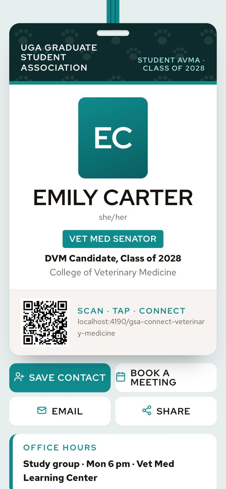

# GSA Connect · Veterinary Medicine

> Clinical teal badge with paw-print pattern.
> **Best for:** DVM students, vet residents and biomedical sciences · **Layout:** Officer

A free, self-hosted **UGA GSA Connect** digital business card, like Popl or Wave, but it's yours. It runs on GitHub Pages and includes:

- 📇 **Save contact**: one tap downloads a vCard (`card.vcf`) to iPhone, Android or Outlook
- 📄 **CV, research, publications, projects**: all driven by one file, `card.json`
- 🔳 **QR code** on the page plus a print-ready `qr.png` / `qr.svg` for posters, badges and NFC cards
- 👛 **Apple Wallet, Google Wallet and Samsung Wallet** passes, built automatically when you add keys
- 📱 **Add to Home Screen** (PWA manifest) and native share sheet
- ✨ Powered by **ScholarTap**



---

## 1 · Make it yours (about 3 minutes)

**Option A: the setup form (recommended).** You only need [Node.js](https://nodejs.org) 20+.

```bash
gh repo create my-card --template ank-man/gsa-connect-veterinary-medicine --public --clone   # or click "Use this template" on GitHub
cd my-card
npm run setup
```

A form opens in your browser with a **live phone preview**:

- 🎨 **choose your template**: all 51 designs (by field: STEM, plants & insects, health, law, humanities, arts…); switching keeps your details
- 📸 drag in your photo (auto-cropped and resized; also used on your Apple Wallet pass)
- 📄 upload your CV (PDF)
- ✍️ fill in your name, title, research, publications, links, office hours…
- 🚀 click **Publish to GitHub**: it commits and pushes for you

First time only: on GitHub, open **Settings → Pages** and set **Source = GitHub Actions**. Your card goes live at
`https://<user>.github.io/my-card/` about a minute later.

**Option B: edit on GitHub, no install.** Click **Use this template**, edit `card.json` in the web editor,
upload `assets/cv.pdf` (and optionally `assets/photo.jpg`), commit, then enable Pages as above.

> Tip: name the repo `<username>.github.io` to get the shortest URL.

### Switching templates later

This repo contains **every** GSA Connect template, so you're never locked into the one you cloned:

- in the setup form: click a design under **Template**
- on GitHub: change `"template": "veterinary-medicine"` in `card.json` (e.g. `"law"`, `"entomology"`, `"music"`) and commit; the build applies it
- in a terminal: `npm run template -- --list`, then `npm run template -- <id>`

Browse them all at https://ank-man.github.io/gsa-connect-kit/

## 2 · Preview locally

```bash
npm run dev        # http://localhost:4173  (no install needed)
npm install        # only needed for QR + wallet pass builds
npm run preview    # full production build in ./dist, served locally
```

> Opening `index.html` by double-clicking won't work; browsers block `fetch("card.json")` from `file://`.

## 3 · Add-to-Wallet buttons

The wallet buttons stay **hidden until a pass is actually built**, so nothing breaks if you skip this.

| Wallet | What you need | Cost |
|---|---|---|
| Apple Wallet | Apple Developer account → Pass Type ID certificate | $99/yr (one account can sign for the whole GSA) |
| Google Wallet | Google Wallet issuer account + service account | Free |
| Samsung Wallet | Samsung Wallet Partner onboarding + approved card template | Free, needs approval |

Add the keys as **repository (or organisation) secrets**. The workflow picks them up on the next push.
Full step-by-step instructions are in **[docs/WALLET-SETUP.md](docs/WALLET-SETUP.md)**.

> 💡 **For the GSA:** put the wallet secrets on the GitHub **organisation** once and every member's card
> repo in that org gets Apple / Google / Samsung passes without paying or configuring anything.

## 4 · Tap-to-share (NFC) & print

Write your card URL to any NTAG213/215 sticker or card and you get a Popl-style tap card for about $1.
See **[docs/NFC-AND-PRINT.md](docs/NFC-AND-PRINT.md)**.

## `card.json` reference

| Field | Used for |
|---|---|
| `template` | Which design to use (`--list` to see all 51) |
| `name`, `pronouns`, `title`, `headline`, `bio` | Header & about |
| `department`, `organization`, `gsaRole`, `location` | Affiliation lines and GSA badge |
| `email`, `phone`, `website`, `calendar`, `cv` | Buttons + vCard |
| `researchInterests[]` | Chips / tags |
| `links[]` `{label, url, icon}` | Icon: `scholar orcid linkedin github research website social video book email phone calendar cv` |
| `publications[]` `{title, authors, venue, year, url}` | Publication list |
| `projects[]`, `education[]`, `awards[]`, `events[]`, `officeHours` | Shown by templates that support them |
| `siteUrl` | Leave blank; CI fills it in. Set it only for a custom domain. |
| `theme.accent` | Override the accent colour (hex) |
| `wallet.*` | Pass colours |
| `brand.*`, `poweredBy` | GSA / ScholarTap branding |

## Custom domain

Add a `CNAME` file containing e.g. `card.yourname.com`, point a DNS CNAME record at `<user>.github.io`,
and set `"siteUrl": "https://card.yourname.com/"` in `card.json`.

## Branding note

This template uses UGA colours and the words "UGA GSA" as text only. Official UGA marks (the Arch, the "G",
logos) need approval from UGA Brand & Licensing before you add them.

---

Made with the [GSA Connect kit](https://github.com/ank-man/gsa-connect-kit) · Powered by **ScholarTap** · MIT licensed
